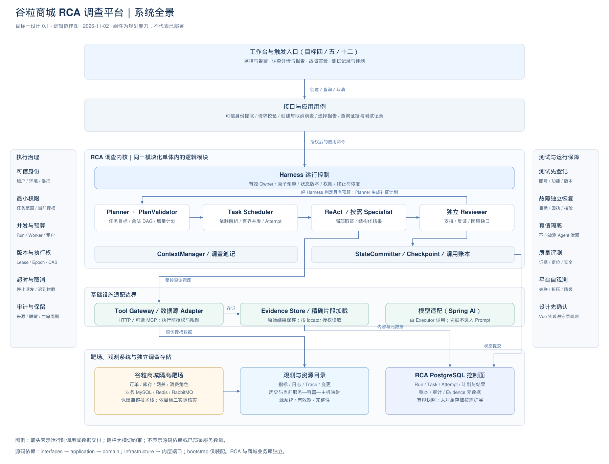
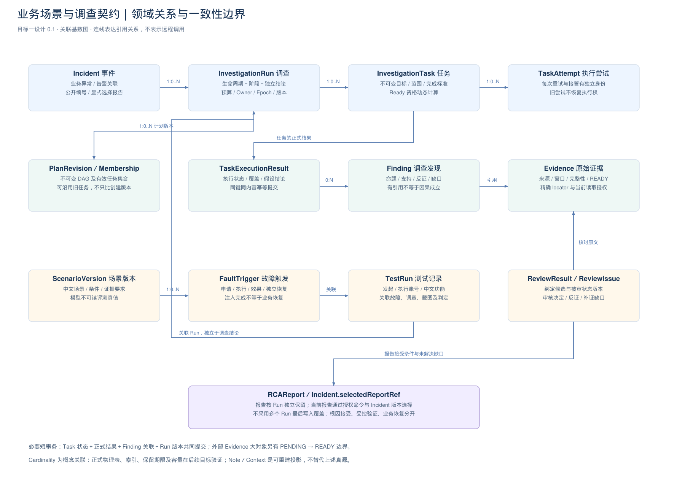
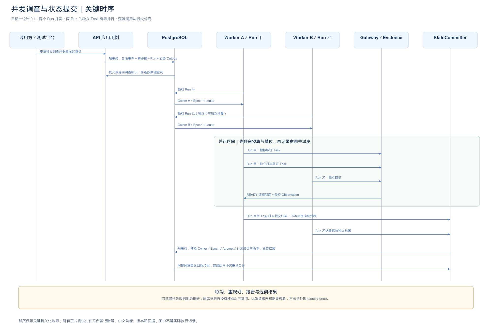

# 技术方案：目标一——业务场景与调查契约

| 项 | 内容 |
| --- | --- |
| 目标／日期／版本 | 面向谷粒商城的证据驱动 RCA 调查平台；目标一；2026-11-02；设计 0.1 |
| 风险 | T2：定义公开契约、并发与状态语义；本次产物为设计，不操作资金和生产资源 |
| 负责人 | 当前设计由 Codex 整理；业务／研发／运维评审人尚未指定，不冒填账号或审批 |
| 设计／实现／验证 | 待评审；未实施应用代码；设计资产核验与业务测试分别记录 |
| 关联规范 | [架构](../../../rules/01-architecture.md)、[接口](../../../rules/03-interface-layer.md)、[领域](../../../rules/04-domain-layer.md)、[基础设施](../../../rules/05-infrastructure-layer.md)、[日常](../../../rules/06-daily-work.md)、[前端](../../../rules/07-frontend.md)、[场景与留痕](../../../rules/08-scenarios-testing-operations.md) |
| 关联资料 | [已有订单方案](../../specs/order-trading-alert-agent.md)、[谷粒商城检查](../../specs/gulimall-integration-assessment.md)、[测试留痕契约](../../specs/testing-and-fault-audit-v2.md) |
| 本目标权威设计 | [领域与调查契约](业务场景与调查契约.spec.md)；[选型决策](技术选型与取舍.md)；附件为契约的结构化表达 |
| 技术基线 | RCA：Java 21＋Spring Boot 3＋Spring AI 的既定方向，PostgreSQL 控制面；谷粒商城保留其兼容栈。没有真实 POM，未声称 BOM／补丁版本已锁定 |
| 实施前版本门槛 | 目标二锁定 JDK／Boot／AI／PostgreSQL／构建工具及验证器的精确版本和兼容记录；契约不依赖跨版本 SDK 方法 |

## 1 背景、目标与非目标

现状是已有工程规范、十二个目标、前端设计和一组调查内核背景 PDF，但缺少对业务场景、调查对象、状态与并发结果的统一可验收契约。若先写循环和页面，各模块容易把告警、事件、调查、测试或恢复混为一个“成功”字段。

本目标产出六件可评审成果：首批场景及优先级；统一术语与模型边界；状态和不变量；接口及结构 Schema；架构图与技术取舍；边界／验收及后续目标交接清单。设计要允许多 Run、Run 内并行取证，保留全部来源与独立结果。

第一闭环采用“订单实例退出导致下单失败”；随后是库存依赖延迟、订单消息消费异常；锁等待、配置退化和支付未知依赖相应靶场条件；观测缺失和目标变化为对照／安全场景。八项均是未执行定义，不把“已设计”计入“已准备／已通过”。

本目标不启动商城、不注入故障、不实现调度器、UI 或重启／回滚执行。这里只定义它们必须遵守的边界，避免为一个技术方案交付未经审核的产品脚手架。

待确认的实施输入：实验主机资源与网络、身份来源、可用模型及数据政策、真实业务基线、支付模拟能力、容量和保留预算。分别由环境、身份、业务、模型、测试负责人在对应目标开始前提供；不阻断本轮设计，阻断相关运行部署及真实测试放行。

## 2 现状、WBS 与改动点

实际工作区只有设计资产与检查快照，没有当前业务应用的 AGENTS.md、ARCHITECTURE.md、POM 或运行代码。用户会话提供的 AGENTS 指令仍适用。本文图和包名是目标设计，不是反向工程出的已部署事实。

| 子目标 | 本次结果 | 依赖 | 风险与验证 | 工作量说明 |
| --- | --- | --- | --- | --- |
| 场景边界 | 八项定义，明确前置条件、观测、正确／不确定结论与禁止动作 | 既有谷粒检查及业务意图 | T2；场景覆盖检查，全部 not_run | 属于同一目标一设计批次；未以未知人力填人日 |
| 模型与状态 | Incident／Run／Task／Attempt、证据与审核契约 | 场景词典 | T2；迁移表、并发冲突和跨字段检查清单 | 共同一致性内容不人为拆为一天小单 |
| 接口与编号 | 请求、返回、错误、幂等与公开编号 | 模型 | T2；Schema、正反例及字段来源检查 | 真实接口实现归后续目标 |
| 选型与架构 | 采用／未采用原因、复议条件及三幅图 | 既有约束、官方资料 | T2；来源及图文一致性检查 | 不按组件多少评判完整性 |
| 验收与交接 | 具体计划用例、完成条件和验证留痕 | 前四项 | T2；所有矩阵行映射明确用例 | 本轮不冒称业务用例已实现 |

| 层／模块（建议） | 契约与职责 | 本次变化 |
| --- | --- | --- |
| interfaces | 认证身份提取、请求／响应／错误转换 | 定义边界；没有新增 Controller |
| application | CreateInvestigation、CancelInvestigation、CommitTaskResult、SelectIncidentReport；模型／工具／审计端口 | 定义用例与提交条件；没有实现编排 |
| domain | Incident、InvestigationRun、Task、状态迁移及权限范围不变量 | 形成候选 Spec；不依赖 Spring AI／ORM |
| infrastructure | PostgreSQL、模型 SDK、数据源、证据内容适配 | 记录接口责任和选型，不交付迁移或已连接数据源 |
| bootstrap | 配置、依赖注入、API／Worker 角色装配 | 后续目标实现，本次只画逻辑与信任边界 |

## 3 依据、技术选型与开源借鉴

完整决策见 [技术选型与取舍](技术选型与取舍.md)，包含两项固定提交和已读 LICENSE 的项目研究，以及十三项决策。比较候选的适用性和代价，不将本项目暂不采用误写为产品不支持。

本次提出：模块化单体＋薄 Harness，PostgreSQL 管理调查控制面，结构化 Spec／JSON Schema 表达协议；内部 UUID 和可读公开编号分离；生命周期／阶段／结论分开。Spring AI Alibaba、Temporal 为可复用或可替换候选，先用领域验收验证适配性。谷粒商城业务 MySQL 与 RCA PostgreSQL 分离，无跨库写事务。

Spring AI Alibaba 提供并行、图与持久化等能力；Temporal 提供持久工作流与活动模型。它们已有的底层协议和基础能力可以复用，但我们的租户范围、证据、任务资格及报告选择不能因为引入框架而省去。[Spring AI Alibaba README](https://github.com/alibaba/spring-ai-alibaba/blob/17e26ff6fe951d605771c1845229ca3edb043634/README.md)、[Temporal README](https://github.com/temporalio/sdk-java/blob/de77db89c65e164b14633744479cd25dc42f0d07/README.md)

选型不是整个技术栈已获发布准入：精确依赖版本、数据库实现与基准测试分别在后续目标完成。MCP、对象存储、完整 Skill 系统不作为目标一必装组件。

## 4 领域模型、架构与状态机

系统图按工作台、接口、调查内核、工具／证据、靶场／观测／存储分层，侧栏列横切治理。它表示运行时逻辑协作，内核各块不代表独立微服务。

领域图展示聚合和引用基数，不是数据库外键 DDL。Incident 一对多 Run，Run 一对多计划版本和 Task，Task 一对多 Attempt；Finding 精确引用 Evidence。TestRun／FaultTrigger 作为独立上下文关联，不替代调查生命周期。

状态以 [Spec 第三节](业务场景与调查契约.spec.md#3-状态维度与迁移) 为准：Run.status 管生命周期，phase 管规划／执行／审核阶段；Task 的执行、证据覆盖与假设判断独立。Reviewer 接受候选不自动等于根因受控验证，更不等于业务恢复。

已发布场景、计划、正式证据和结果保持历史可解释性。纠正通过新版本／补充／失效原因；任务被计划取代与证据被判无效是两种不同操作。

## 5 接口与契约设计

以下为后续目标实现的候选 HTTP 契约；目标一交付字段与语义，不声称路径已可访问。结构定义见 [Schema](附件/调查契约.schema.json)，跨字段及业务规则以 Spec 为准。

| 操作 | 输入与可信字段 | 输出／授权／幂等 |
| --- | --- | --- |
| POST /api/v1/incidents/{incidentId}/investigations | 调查目标、请求缩小范围、配置 profile、expectedIncidentVersion；账号／tenant 不取客户端自报 | 持久化接收后 202＋runId／公开编号／查询 URL；Idempotency-Key 在租户＋主体＋操作作用域内去重 |
| GET /api/v1/investigations/{runId} | 路径内部 ID；可信会话授权 | 生命周期、阶段、独立结论、进度、配置及证据可用性；不返回凭据和原始大日志 |
| POST /api/v1/investigations/{runId}/cancel | expectedStateVersion、中文原因 | 已受理取消与已完成取消分开；重复请求返回当前事实，不能承诺撤销外部动作 |
| POST /api/v1/incidents/{incidentId}/selected-report | reportId、expectedIncidentVersion、选择理由 | 报告属于同租户事件且有发布权限才选择；不同 Run 不自动覆盖 |
| GET /api/v1/scenarios | 角色和环境范围、游标及 pageSize | 人工／测试管理员的场景索引，默认页 20、上限 100（候选接口容量边界）；被测 Agent 不可访问真值目录 |
| GET /api/v1/evidence/{evidenceId}/fragments | 类型化 locator 及有界 limit | 重新鉴权后返回脱敏片段、来源和完整性；无权读取不暴露其他租户对象存在性 |

JSON 请求建议上限 64 KiB，中文文本目标去首尾空白后为 1—1000 字符且有中文说明，服务 ID 列表 1—20 个（去重），时间窗 start&lt;end 且不能超服务端 profile；这些为明确可调的设计准入边界，不是性能实测。原始日志和上传附件使用独立有配额入口，不塞创建调查请求。输入不静默截断，不支持由用户直接设置 status、Epoch、权限或模型消费账本。

同键同规范化意图摘要返回原 Run；不同摘要返回冲突。摘要包含接口版本、目标、请求范围、调用方提交的配置引用及前置版本；字段排列、服务集合排列和等价时区表达规范化后比较。先查既有键，再为首次创建解析当前生效配置；既有键重试复用原 Run 的配置快照，不能因 profile 已更新而误判为新意图或静默升级模型。重新读取仍检查当前访问权限。幂等记录至少覆盖关联 Run 的完整存续与重试窗口；清理后同键不得静默创建新调查，返回显式 KEY_EXPIRED 并要求新键。发布前确定实际保留期限，清理期间保留满足查询和审计要求的墓碑。

| 错误 | HTTP | 行为 |
| --- | --- | --- |
| INVALID_REQUEST／未知字段 | 400 | 修正格式，不重试相同坏请求 |
| UNAUTHENTICATED | 401 | 获取合法会话 |
| NOT_FOUND_OR_NOT_VISIBLE | 404 | 统一处理不存在与不可见对象，不泄露跨租户存在性 |
| OPERATION_FORBIDDEN | 403 | 当前可见对象不具备该动作权限，不让模型换工具绕过 |
| VERSION_CONFLICT／IDEMPOTENCY_CONFLICT／KEY_EXPIRED | 409 | 查询最新状态；同键异参或键过期需要新意图 |
| DOMAIN_CONSTRAINT_VIOLATION | 422 | 修正语义、时间窗或前置条件 |
| QUOTA_EXCEEDED | 429 | 按服务端提示等待／缩小负载，不绕过配额 |
| DEPENDENCY_UNAVAILABLE | 503 | 未可靠接收时不返回成功；写结果未知则按原幂等键查询 |

错误响应包含 code、中文说明、requestId、retryable、retryAfter（适用时），不返回堆栈或凭据。可靠接收与响应之间断连时客户端用原键查询／重试，不把超时当作未创建。

## 6 时序、事务与执行流程

创建链路：认证与结构检查→当前授权／profile 解析→短事务锁定合法 Incident 版本、分配公开编号、写 Run＋幂等记录＋必要 Outbox→提交→返回 202。模型、远端授权网络请求和外部工具不在该事务内；授权撤销与派发竞态在每次工具实际执行前再次校验。

Run 领取链路：本地接纳容量检查→数据库短事务领取 Run 并授予 Owner／新 Epoch／Lease→释放事务→在 Owner 内计算 Ready Tasks。Task 派发前先预留槽位，再原子创建 Attempt、预留预算并改任务状态。线程池拒绝要记录 NOT_STARTED、补偿并释放槽位；进程先崩溃由后续接管核验，不能只凭 RUNNING 判断工具已执行。

工具链路：持久化 ModelTurn 与逻辑 ToolCall Intent→事务外受控调用→原始证据持久化并确认 READY→短事务核验当前执行资格，提交 ToolCallResult／工具响应／Checkpoint→后续模型轮次。对象存储成功不等于调查提交成功，READY 之前不把证据作为已保存事实交给模型。

结果提交链路：StateCommitter 核验 Run 状态／Owner／Epoch／Lease、Attempt、任务契约与当前 Plan membership→检查 submissionKey 及结果摘要→短事务保存 Finding／引用／TaskResult／Task 状态／版本／必要 Outbox。相同键不同结果不覆盖；普通状态版本冲突重读并判断能否合并。

Reviewer 在事务外审核，结果提交核验被审报告及关键证据适用性。新增无关证据不必一律废弃审核；新增反证或候选发生实质改变则重新审核，保留旧记录。

## 7 边界与异常矩阵

每项是计划验证，不代表类已经存在或测试已经通过；真实执行要由平台登记并关联实际报告。

| 场景 | 影响／状态语义 | 如何检测 | 处理策略 | 恢复／补偿 | 计划验证标识 → 实际证据 | 观测 |
| --- | --- | --- | --- | --- | --- | --- |
| 输入空／超长／额外状态字段 | 不创建调查 | 字段、大小、允许集合校验 | 400／422，不静默截断 | 用户修正新请求 | shouldRejectInvalidInvestigationInput → 未运行 | 拒绝类别 |
| 客户端伪造租户／账号 | 不能获得额外范围 | 可信身份与请求白名单 | 拒绝敏感字段，服务端补身份 | 记录审计 | shouldRejectCallerSuppliedAuthority → 未运行 | 授权拒绝 |
| 同键同参并发创建 | 仅一个逻辑 Run | 唯一约束及摘要 | 返回同一 Run | 响应丢失按原键查询 | shouldReturnSameRunForConcurrentDuplicateRequest → 未运行 | 重复接收 |
| 同键不同参数 | 协议冲突 | 摘要比较 | 409，不覆盖 | 新意图使用新键 | shouldRejectSameKeyWithDifferentRequest → 未运行 | 键冲突 |
| 重试期间 profile 已更新 | 原调查配置不能悄悄改变 | 先查原意图与绑定快照 | 同键同意图仍返回原 Run | 新配置另建明确新意图 | shouldReuseOriginalConfigurationOnIdempotentRetry → 未运行 | 配置快照复用 |
| 相同显示名／IP 对应不同实例 | 资源不能误关联 | 完整身份＋历史有效期 | 保留身份冲突，不认定可操作目标 | 重新解析，建议重新生成 | shouldRejectAmbiguousResourceIdentity → 未运行 | 目标未确认 |
| 并发分配公开编号／日界／序号增长 | 编号不冲突不截断 | 原子计数器、唯一约束、固定时区 | 同事务分配，不按 JVM 时钟回拨复用 | 允许空号，异常重读当前桶 | shouldAllocateUniqueSemanticIdentifiers → 未运行 | 发号冲突 |
| 两个不同 Run 并发 | 状态与证据不串线 | Run／租户归属及执行记录 | 各自推进，遵守全局配额 | 一方失败不误结束另一方 | shouldIsolateConcurrentInvestigationRuns → 未运行 | 活跃／排队 |
| 两个 Worker 竞争同一 Run | 单一有效 Owner | 原子领取＋Lease／Epoch | 只有有效执行权可推进 | 失效后接管 | shouldGrantOneEffectiveRunOwner → 未运行 | 领取竞争 |
| 两 Task 同时提交 | 不能丢失 Finding | stateVersion／提交键 | 安全追加重读合并，实质冲突拒绝 | 保留待提交结果 | shouldMergeIndependentTaskResultsWithoutLostUpdate → 未运行 | 版本冲突 |
| 旧 Epoch／过期 Attempt 迟到 | 不污染当前状态 | 执行资格检查 | 拒绝当前状态写入 | 真实原始材料按受控流程核验复用 | shouldRejectStaleOwnerCommit → 未运行 | 陈旧写拒绝 |
| 重规划沿用旧 Task | 仍有效任务可继续 | 当前 membership＋scopeVersion | 不只比较创建 revision | 不适用旧任务取消／替换 | shouldAcceptRetainedTaskAcrossPlanRevisions → 未运行 | 计划变更 |
| 上游终止但必需证据未就绪 | 不同依赖边不能混判 | 每边条件及证据要求 | WAITING 或 IMPOSSIBLE，不把分支结束当证据齐备 | 有价值时补证，否则显式跳过／失败 | shouldResolveEachDependencyByItsOwnCondition → 未运行 | 依赖阻塞原因 |
| Attempt 失败后允许有限重试 | 不覆盖旧尝试也不重开终态 Task | 预算、幂等、Task 是否尚未终结 | 新 Attempt；最终失败后不自动复活 | 显式新调查／新计划目标保留来源 | shouldPreserveAttemptHistoryAndTaskTerminality → 未运行 | 重试与最终失败 |
| 取消与完成／审核竞争 | 终态不回退 | 短事务状态条件与版本 | 以已提交合法事实裁决 | 返回当前结果，保留另一请求审计 | shouldResolveCancelCompletionRace → 未运行 | 取消阶段 |
| 槽位已预留但线程池拒绝 | 任务尚未启动 | submit 拒绝＋Attempt | NOT_STARTED，补偿状态 | 释放额度，预算账本按已发起事实核验 | shouldRecoverRejectedTaskDispatch → 未运行 | 拒绝／积压 |
| 工具超时或返回迟到 | 远端结果可能未知 | Deadline、ToolCall Ledger | 停新步骤，结果分类 | 只读可有限重查；写动作先对账 | shouldPreserveUnknownToolOutcome → 未运行 | 未知调用 |
| 查询为空／失败／截断 | 不能等于业务正常 | 统一结果与 completeness | EMPTY／FAILED／PARTIAL 分开 | 替代取证或保留缺口 | shouldDistinguishEmptyPartialAndFailedEvidence → 未运行 | 数据可用性 |
| 证据 PENDING／哈希或 locator 错误 | 不具备正式引用资格 | READY、字节完整性及定位检查 | 拒绝正式 Finding 引用 | 补登记／重新采集，不编造原文 | shouldRejectUnreadyOrInvalidEvidenceCitation → 未运行 | 存储／引用失败 |
| 摘要丢反证／日志提示注入 | 不改变权限及事实 | 结构引用、角色边界、语义核验 | 拒绝升级为指令／确定根因 | 用已提交结构化数据重建 Context | shouldRetainCounterEvidenceAndRejectInjectedAuthority → 未运行 | 上下文拒绝 |
| Reviewer 审核期间新增关键反证 | 原审核可能失效 | 被审版本与影响分析 | 重新核验／审核，不覆盖原结果 | 记录新的审核轮次 | shouldRecheckReviewAfterMaterialEvidenceChange → 未运行 | 审核重开原因 |
| 达预算／无进展／补证路径耗尽 | 正常受控结束也可无结论 | 原子预算、进展、Deadline | 停止新派发，输出 INCONCLUSIVE | 留已有证据与人工接管入口 | shouldFinishInconclusiveWithoutOverrunningBudget → 未运行 | 停止原因 |
| 两 Run 发布不同报告 | Incident 不最后写入获胜 | expectedIncidentVersion＋显式选择 | 冲突保留两份，授权人复核 | 重读后显式选择 | shouldPreventLastWriterWinsForIncidentReport → 未运行 | 报告选择冲突 |
| 业务故障恢复但调查未结束／反向情况 | 两生命周期独立 | 业务验证引用与 Run 状态 | 分别展示，不自动互相关闭 | 按各自契约收尾 | shouldSeparateInvestigationAndBusinessRecovery → 未运行 | 恢复证据 |
| 真值／标注答案混入 Context | 评测失真 | 证据来源与投影允许集合 | 阻断模型调用并审计 | 重建无泄漏输入，受影响结果无效 | shouldExcludeFaultTruthFromAgentContext → 未运行 | 真值泄漏 |
| 测试平台不可用／截图不适用 | 不伪装已合规触发／已取证 | 触发登记与证据状态 | 新受控测试不启动；后台截图注明原因 | 外部文档核验如实留来源 | shouldKeepTestProvenanceAndArtifactApplicability → 未运行 | 测试阻塞 |
| 数据库提交前后故障／ACK 丢失 | 业务结果可能未知 | 提交键与事务结果重查 | 不重复创建／不虚报成功 | 按持久事实继续或核验 | shouldReconcileCommitAfterAcknowledgementLoss → 未运行 | 提交未知 |
| 未知枚举／旧契约运行恢复 | 不能错误升级权限或状态 | 契约版本及消费者能力 | 明确不支持，保留旧解释器 | 按兼容版本读取／迁移方案处理 | shouldRejectUnsupportedContractVersionSafely → 未运行 | 兼容拒绝 |

## 8 并发、幂等与一致性

多 Run 并发、Run 内独立 Task 并发均是首个可运行版本验收条件。目标七至少演示两个 Run 同时推进，以及同 Run 中两个无依赖 Task 并行；这只是正确性验证场景，不是生产容量上限。

并发额度分 Run、Worker、租户／环境及具体数据源。JVM Semaphore 只管理本地槽位，跨 Worker 配额使用可信共享原子账本。每次 Planner／Executor／Specialist／Reviewer／上下文压缩模型调用都消耗同一 Run 预算；重试、重规划和接管不重置预算。预留后崩溃需核验已发起事实，不能随意退回未知用量。

幂等分四类：创建请求 key 防重复意图；ToolCall ID 识别逻辑请求；requestFingerprint 判断查询是否可复用；submissionKey＋摘要防结果重复提交。它们不共用一个“参数哈希就是唯一 ID”。

StateCommitter 是统一规则入口，不是把所有 Run 串行化的全局锁：不同 Run 使用各自事务与版本，独立提交；同 Run 的冲突按可合并性重读处理。排队采用严重性、等待时间与租户额度共同决定，避免单个大调查耗尽 Worker 或普通任务长期饥饿。

PostgreSQL 领取采用短事务条件更新及可用的 SKIP LOCKED，外部请求在事务外；不将领取行锁当几分钟的所有权，不承诺外部 exactly-once。[PostgreSQL SELECT](https://www.postgresql.org/docs/17/sql-select.html)

必要一致性约束：公开编号唯一；Run 内 Task 与 Attempt 归属合法；同一逻辑提交键结果不可变；同 Run 只有一个有效 Owner；预算原子；一个报告选择版本只能由一个成功条件更新推进。物理表／索引／DDL 和实测隔离级别留给目标七，目标一固定这些验收语义。

## 9 失败模式与恢复 F1—F5

| 类别 | 本目标必须明确的语义 | 后续验证 |
| --- | --- | --- |
| F1 依赖故障 | 模型／观测／权限／数据库不可用与无结果分开；依赖失败不伪装正常 | 错误分类、替代调查、有界重试、拒绝默认授权 |
| F2 资源故障 | 并发、连接、上下文、查询结果大小、预算均有边界 | 有界队列、原子额度、拒绝补偿、关键证据保留 |
| F3 状态故障 | 重复、乱序、计划变更、Owner 接管、提交与远端状态分开 | 五个崩溃窗口及陈旧结果矩阵 |
| F4 输入故障 | 结构合法不等于授权／引用／因果成立；日志为不可信数据 | 越权、非法定位、提示注入与范围冲突 |
| F5 操作故障 | 错误场景版本、错误映射、错误配置或人工关闭不等于恢复 | 固定版本、预检、显式选择、审计和回退 |

F3 五窗口：意图前崩溃可重新规划但模型可能不同；意图后派发前复用已提交意图；已发出未知按工具能力核验；外部成功本地未提交优先核对／复用已存材料；本地提交后通知失败使用持久发布记录重试，不能再次执行业务动作。只读重查也保留新 ProviderAttempt 和采集时间。

## 10 测试与评测方案

本轮是设计资产检查，未运行真实订单单测／组件测试。正式业务验证依 [测试平台契约](../../specs/testing-and-fault-audit-v2.md) 先登记再执行，保留发起账号、执行账号、中文一句话功能、版本、故障／告警／事件、根因、Agent 状态、任务完成、证据和独立判定。后台单测截图不适用，原生 XML／日志仍要保留。

| 层次 | 目标一验收方法 | 实施目标 |
| --- | --- | --- |
| 设计资产 | 十二章、引用、图源／导出、字段词典、Schema 引用及示例标记核对 | 本轮；单独记录外部本地核验，不计平台合规量 |
| 领域单元 | 非法迁移、维度组合、编号、版本及任务资格 | 目标七／八 |
| 契约／安全 | 请求额外字段、错误、幂等、可见性及证据授权 | 目标四至九 |
| 数据库组件 | 并发创建／领取／提交、唯一约束、报告选择、租约接管 | 目标七／十一 |
| 模型评测 | 身份定位、证据支持、因果缺口、反证、安全建议、拒绝猜测 | 目标八至十二 |
| 故障／恢复 | 进程中断、未知 ToolCall、存储两阶段、预算与取消竞态 | 目标十一／十二 |

单元测试由项目原生运行器、CI 或平台执行适配调用，不新增自定义运行单测包装脚本。测试类／命令在实际项目建立后写入平台用例，当前矩阵中的用例名均为计划标识。

评测真值与测试执行记录独立授权。根因正确率、证据支持、越权行为、精确目标、安全建议及耗时／Token 分别统计；不让高平均分抵消危险建议。评测数据包括单根因、多因素、无足够证据及采集故障；正式保留集在来源、脱敏和标签复核后建立，当前为零。

## 11 观测、审计与平台自身告警

每个状态转换记录主体、对象、前后版本、原因、时间和关联请求；执行审计与监控指标分开，审计依赖可靠持久事实。Trace／日志可以携带关联 ID，指标标签只用有界的环境、组件、阶段、错误类和结论枚举。

需观测：排队与运行时长、活跃／拒绝／超时任务、预算预留与未知用量、状态提交冲突、旧 Epoch 拒绝、证据保存／读取失败、报告缺口、平台登记／产物上传失败、Outbox 积压。告警依据实际影响和持续窗口配置，目标一不臆定阈值。

关键降级必须面向人可见：观测不可用不能显示业务健康；Agent 心跳未知不能显示“正常执行”；报告已生成不能显示故障已恢复；人工关闭需标明恢复未核验。责任人与通知渠道在环境及值班能力建立后配置，未配置不得宣称可以通知到人。

## 12 版本发布、回退、评审与交接

本轮发布是设计版本 0.1；原 Rules、V1／V2 界面图、历史压缩包保持原样，不静默用新状态替换旧运行数据。后续获评审的契约、场景和配置以不可变版本发布，Run 绑定实际版本。

先以首个场景、隔离环境和受限账号完成端到端，再扩大场景和并发；停止条件包含跨租户读取、真值泄漏、陈旧提交、误判已恢复或不安全建议。停止新派发与在途请求处理分别执行，不能把关闭开关当取消远端操作。

契约回退要保证旧运行和已有引用仍可解释；破坏性变更按新版本和前向迁移处理。回退模型／Prompt 不撤销已提交事实，回退应用不撤销订单或支付结果。

| 评审范围 | 当前状态 | 放行条件 |
| --- | --- | --- |
| 目标一场景与调查边界 | 待用户／业务评审 | 首个场景、观察范围、允许不确定结论及非目标获确认 |
| 模型、状态、并发与编号 | 待研发／领域评审 | 不变量和迁移表无歧义，多个 Run 报告选择规则明确 |
| 安全、证据与测试隔离 | 待安全／测试评审 | 身份来源、真值隔离、独立恢复与证据访问约束明确 |
| 环境与版本 | 待目标二提供 | 主机、BOM、支持版本、模型与数据政策、构建／验证器确定 |
| 当前设计资产 | 见本目录核验记录 | 图、链接、结构与示例检查据实；未实施业务检查保持未运行 |

目标一完成标准是：这些设计资产可评审、关键决策及边界明确、每个边界能映射具体计划验证、后续目标知道接收什么契约。设计交付、设计获批、应用实现、业务验证、发布允许分别记录。
